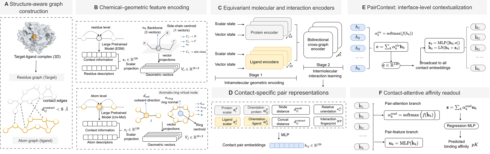
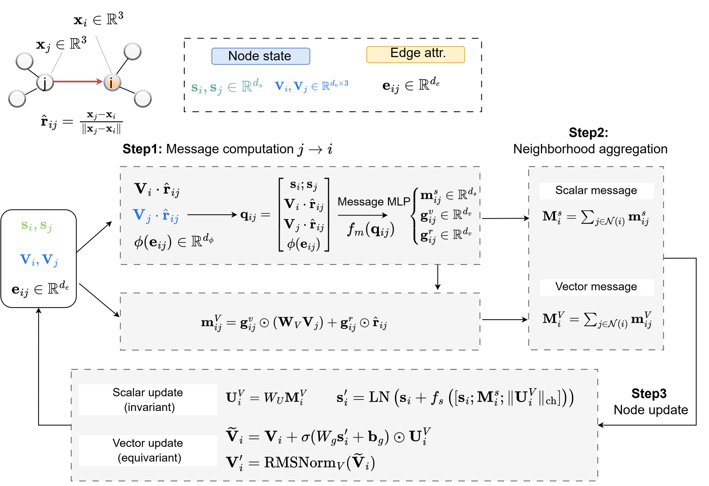
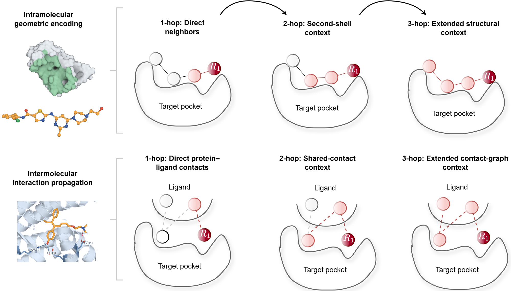

# Contact-Level Geometric Learning for Scalable Molecular Interaction Modeling

[](LICENSE)


[](https://zuolong-cyber.github.io/uni-affinity-page/)



A geometry-aware framework for protein–ligand binding affinity prediction. Given a pocket and a ligand pose,
crystallographic or co-folded, the model predicts pK. It constructs geometric vectors from chemically
defined local frames and propagates them by angle-aware SE(3)-equivariant message passing, parameterized
separately for intramolecular and intermolecular interactions; the interface is represented by the contacts
that are actually formed, each contributing an interpretable energy term that attention aggregates into the
prediction. To support learning from co-folded structures at scale, `cofold_filter/` assesses structural
quality and hallucination risk jointly and stratifies complexes into accepted, uncertain and rejected.

## 1. Setup

```bash
python -m venv .venv && source .venv/bin/activate
pip install -r requirements.txt
```

Tested with torch 2.14.1 / numpy 2.4.6 / pandas 3.0.6 / rdkit 2026.09.1 on Python 3.11.

## 2. Quick start

**Reproduce the released predictions** — scores the bundled complexes with the released checkpoint and
compares each prediction against `smoke/expected.json`:

```bash
python smoke/run_smoke.py
```

```
[data] train=0, valid=0, test=64
[smoke] n=64  max |delta| = 7.55e-06 on 5k0m  (tolerance 0.0001)
[smoke] S3_cold_target_seq30cc/seed0 test split (n=1609): Pearson r = 0.5481, RMSE = 1.7123
[smoke] PASS
```

The third line is one seed, not an average.

**Check the model's invariants** — equivariance of the message-passing layer, invariance of the prediction
under rigid motion, featurization from PDB/SDF, and state-dict loading:

```bash
python -m unittest discover -s tests
```

## 3. Model

`uniaffinity/model.py`. One scalar–vector message-passing layer, the unit the protein, ligand and interface
stages are all built from:



Scalars reach vectors only through norms and dot products, and vectors are only scaled by scalars and mixed
linearly across channels, so the scalar state stays invariant and the vector state equivariant under SE(3).

Each stage is three such layers, which is what gives a contact its receptive field along the residue graph
(top) and across the interface (bottom):



## 4. Released checkpoint

`smoke/checkpoint/model.pt`, trained on `S3_cold_target_seq30cc` seed 0. Scoring a structure outside the
bundled cache needs ESM-2 650M and Uni-Mol features first, in the layout [DATA.md](DATA.md) gives.

## 5. Training on PDBbind

Get PDBbind v2020 from [pdbbind.org.cn](http://www.pdbbind.org.cn/) (registration required) and build the
ESM-2 / Uni-Mol caches in the layout [DATA.md](DATA.md) specifies. What the config expects to find:

```
/data/pdbbind_v2020/
  index.csv                      pdb_id, pK, relation, affinity_type, uniprot_id, pocket_pdb, ligand_sdf, ligand_mol2
  structures/<pdb_id>/...        whatever the three path columns point at
/data/cache/esm2_650m/<pdb_id>.pt
/data/cache/unimol/<pdb_id>.pt
```

Copy the config and point it there:

```bash
cp configs/smoke.yaml configs/pdbbind.yaml
```

```yaml
data:
  root: /data/pdbbind_v2020
  index_root: /data/pdbbind_v2020
  structure_fallback_roots: [/data/pdbbind_v2020]
  csv: index.csv
pretrained:
  esm:
    cache_dir: /data/cache/esm2_650m
  unimol:
    cache_dir: /data/cache/unimol
```

Featurize once. The cache is keyed by the graph settings, so every run that shares them reuses it:

```bash
python -m uniaffinity.cli prepare --config configs/pdbbind.yaml \
    --set data.split_file=data/splits/S3_cold_target_seq30cc/seed0.csv
```

Then one run is one split × one seed:

```bash
python -m uniaffinity.cli train --config configs/pdbbind.yaml \
    --set data.split_file=data/splits/S3_cold_target_seq30cc/seed0.csv \
    --set experiment.seed=0 \
    --set experiment.run_dir=runs/S3_cold_target_seq30cc/seed0
```

Without `experiment.run_dir` the run goes to `runs/<name>_<timestamp>/`. It writes:

```
runs/S3_cold_target_seq30cc/seed0/
  config.yaml               the resolved config, --set overrides included
  checkpoints/best.pt       selected on valid rmse
  predictions/              valid.csv, test.csv
  summary.json              best epoch, valid and test metrics
```

A full setting is five seeds:

```bash
for split in S1_random S3_cold_target_seq30cc S4_cold_both; do
  for seed in 0 1 2 3 4; do
    out=runs/$split/seed$seed
    [ -d "$out" ] && continue
    python -m uniaffinity.cli train --config configs/pdbbind.yaml \
        --set data.split_file=data/splits/$split/seed$seed.csv \
        --set experiment.seed=$seed \
        --set experiment.run_dir=$out
  done
done
```

Re-scoring a finished run, or any checkpoint, on a split of its own config:

```bash
python -m uniaffinity.cli evaluate --checkpoint runs/S3_cold_target_seq30cc/seed0/checkpoints/best.pt \
    --split test
```

Scoring poses that are not in an index. One pose, with the contacts the readout attended to:

```bash
python -m uniaffinity.cli predict --checkpoint smoke/checkpoint/model.pt \
    --protein pocket.pdb --ligand ligand.sdf --pdb-id my_complex --top-k 3
```

```json
{
  "pdb_id": "my_complex",
  "predicted_pK": 8.0405,
  "top_contacts": [
    {"protein_node": 17, "ligand_node": 0,  "attention": 0.00308},
    {"protein_node": 17, "ligand_node": 12, "attention": 0.00303},
    {"protein_node": 45, "ligand_node": 8,  "attention": 0.00298}
  ]
}
```

`protein_node` indexes the pocket residues in the order the featurizer kept them, `ligand_node` the ligand
heavy atoms followed by the aromatic virtual nodes.

Many poses, from a CSV of `id,protein,ligand` paths:

```bash
python -m uniaffinity.cli predict --checkpoint smoke/checkpoint/model.pt \
    --csv poses.csv --output scored.csv
```

```
id,predicted_pK,error
my_complex,8.0405,
```

Both read the pretrained features from the `cache_dir` written into the checkpoint's config, and zero-fill
with a warning when a pose has none.

## 6. Splits

Ten settings, each a directory of `pdb_id,split` CSVs -- five seeds, except the time split, which is a
single chronological cut-off and has one. `summary.csv` carries the sizes of every one of them.

```bash
python - <<'EOF'
import pandas as pd
print(pd.read_csv("data/splits/summary.csv").query("seed == 0").to_string(index=False))
EOF
```

The two "cold target" settings are not the same experiment: `S3` removes a protein together with everything
transitively related to it, so almost no test complex keeps a close training relative, while `S3b` removes
only the cluster itself and a substantial minority of test proteins still have one.
[DATA.md](DATA.md) has the rest.

## 7. License

Code: MIT, see [LICENSE](LICENSE). The splits and the smoke-test graphs are released under the same terms.

`data/sair_metadata_accepted.csv.gz` is derived from **SAIR** (SandboxAQ), released under
[CC BY 4.0](https://creativecommons.org/licenses/by/4.0/), and is redistributed here under that same
licence. If you use it, cite SAIR as well as this work; see [DATA.md](DATA.md).

## 8. Citation

A reference will be added here when the paper is available.
