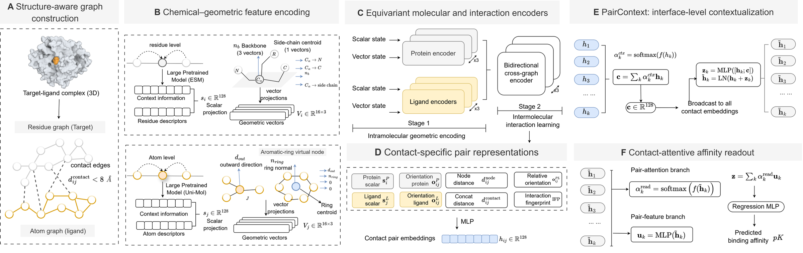
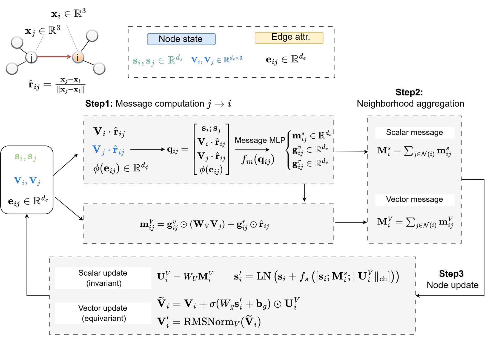
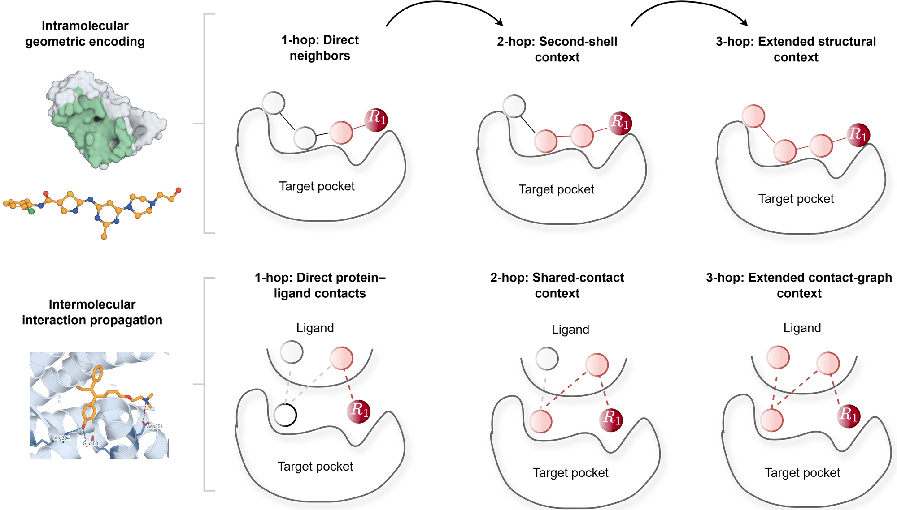

# Contact-Level Geometric Learning for Scalable Molecular Interaction Modeling

[](LICENSE)


[](https://zuolong-cyber.github.io/uni-affinity-page/)



A geometry-aware framework for protein–ligand binding affinity prediction. Given a pocket and a ligand pose,
crystallographic or co-folded, the model predicts pK. It constructs geometric vectors from chemically
defined local frames and propagates them by angle-aware SE(3)-equivariant message passing, parameterized
separately for intramolecular and intermolecular interactions; the interface is represented by the contacts
that are actually formed, each contributing an interpretable energy term that attention aggregates into the
prediction. To support learning from co-folded structures at scale, `cofold_filter/` assesses structural
quality and hallucination risk jointly and stratifies complexes into accepted, uncertain and rejected.

## Setup

```bash
python -m venv .venv && source .venv/bin/activate
pip install -r requirements.txt
```

Tested with torch 2.14.1 / numpy 2.4.6 / pandas 3.0.6 / rdkit 2026.09.1 on Python 3.11. No torch-geometric,
the graphs and the batching are plain tensors.

## Quick start

Everything these need is in the repository: no PDBbind, no ESM-2 and no Uni-Mol download, and all three run
on CPU in about a minute.

```bash
python smoke/run_smoke.py                     # released checkpoint vs. the paper's predictions
python -m unittest discover -s tests          # equivariance, checkpoint agreement
python cofold_filter/demo/run_demo.py         # the co-folding filter on three cases
```

```
[data] train=0, valid=0, test=64
[smoke] n=64  max |delta| = 7.55e-06 on 5k0m  (tolerance 0.0001)
[smoke] S3_cold_target_seq30cc/seed0 test split (n=1609): Pearson r = 0.5481, RMSE = 1.7123
[smoke] PASS
```

The 64 complexes are a uniform random sample (seed 0) of that test split, scored with the released weights
and compared prediction by prediction against the run reported in the paper; details in
[smoke/README.md](smoke/README.md), and the filter in [cofold_filter/README.md](cofold_filter/README.md).

## Model

`uniaffinity/model.py`. One scalar–vector message-passing layer, the unit the protein, ligand and interface
stages are all built from:



Scalars reach vectors only through norms and dot products, and vectors are only scaled by scalars and mixed
linearly across channels, so the scalar state stays invariant and the vector state equivariant under SE(3).
`tests/test_model.py` checks both numerically, at the layer level and end to end.

Each stage is three such layers, which is what gives a contact its receptive field along the residue graph
(top) and across the interface (bottom):



## Released checkpoint

`smoke/checkpoint/best.pt` (10.5 MiB) is the released model: seed 0 of the `S3_cold_target_seq30cc` split,
the cold-target setting. It carries its own config, so `evaluate` and `predict` need no YAML. Optimizer
state is stripped, so it can be scored from and fine-tuned, but the original run cannot be resumed. It is
covered by this repository's licence.

Scoring a structure that is not in the bundled cache additionally needs ESM-2 650M and Uni-Mol to build the
node features; those weights are distributed by their own authors under their own terms, and [DATA.md](DATA.md)
gives the layout the featurizer expects.

## Training on PDBbind

Get PDBbind v2020 from [pdbbind.org.cn](http://www.pdbbind.org.cn/) (registration required) and build the
ESM-2 / Uni-Mol caches in the layout [DATA.md](DATA.md) specifies. What the config expects to find:

```
/data/pdbbind_v2020/
  index.csv                      pdb_id, pK, relation, affinity_type, uniprot_id, pocket_pdb, ligand_sdf, ligand_mol2
  structures/<pdb_id>/...        whatever the three path columns point at
/data/cache/esm2_650m/<pdb_id>.pt
/data/cache/unimol/<pdb_id>.pt
```

Copy the config and point it there:

```bash
cp configs/smoke.yaml configs/pdbbind.yaml
```

```yaml
data:
  root: /data/pdbbind_v2020
  index_root: /data/pdbbind_v2020
  structure_fallback_roots: [/data/pdbbind_v2020]
  csv: index.csv
pretrained:
  esm:
    cache_dir: /data/cache/esm2_650m
  unimol:
    cache_dir: /data/cache/unimol
```

Featurize once. The cache is keyed by a hash of the graph settings, so every run that shares them reuses it
(about 7 GB for PDBbind, a few hours on a many-core node):

```bash
python -m uniaffinity.cli prepare --config configs/pdbbind.yaml \
    --set data.split_file=data/splits/S3_cold_target_seq30cc/seed0.csv
```

Then one run is one split × one seed, a few hours on a 24 GB GPU:

```bash
python -m uniaffinity.cli train --config configs/pdbbind.yaml \
    --set data.split_file=data/splits/S3_cold_target_seq30cc/seed0.csv \
    --set experiment.seed=0 \
    --set experiment.run_dir=runs/S3_cold_target_seq30cc/seed0
```

`--set section.key=value` works on `prepare` and `train` and only accepts keys that already exist, so a typo
raises instead of being silently ignored. Without `experiment.run_dir` the run goes to
`runs/<name>_<timestamp>/`. It writes:

```
runs/S3_cold_target_seq30cc/seed0/
  config.yaml               the resolved config, --set overrides included
  code_snapshot/            uniaffinity/*.py as it was for this run
  train.log                 one line per epoch
  metrics.jsonl             the same numbers, machine-readable
  checkpoints/best.pt       selected on valid rmse; last.pt alongside it
  predictions/              valid.csv, test.csv
  summary.json              best epoch, valid and test metrics
```

```bash
tail -f runs/S3_cold_target_seq30cc/seed0/train.log
```

A full setting is five seeds. `train` refuses to write into an existing run directory, so a re-run of the
loop picks up where it stopped:

```bash
for split in S1_random S3_cold_target_seq30cc S4_cold_both; do
  for seed in 0 1 2 3 4; do
    out=runs/$split/seed$seed
    [ -d "$out" ] && continue
    python -m uniaffinity.cli train --config configs/pdbbind.yaml \
        --set data.split_file=data/splits/$split/seed$seed.csv \
        --set experiment.seed=$seed \
        --set experiment.run_dir=$out
  done
done
```

Mean and spread over the seeds of each setting:

```bash
python - <<'EOF'
import json, pandas as pd
from pathlib import Path
rows = [{"split": p.parts[1], "seed": p.parts[2], **json.loads(p.read_text())["test"]}
        for p in sorted(Path("runs").glob("*/*/summary.json"))]
print(pd.DataFrame(rows).groupby("split")[["rmse", "pearson", "spearman"]].agg(["mean", "std"]).round(3))
EOF
```

Re-scoring a finished run, or any checkpoint, on a split of its own config:

```bash
python -m uniaffinity.cli evaluate --checkpoint runs/S3_cold_target_seq30cc/seed0/checkpoints/best.pt \
    --split test
```

Scoring poses that are not in an index. One pose, with the contacts the readout attended to:

```bash
python -m uniaffinity.cli predict --checkpoint smoke/checkpoint/best.pt \
    --protein pocket.pdb --ligand ligand.sdf --pdb-id my_complex --top-k 3
```

```json
{
  "pdb_id": "my_complex",
  "predicted_pK": 8.0405,
  "top_contacts": [
    {"protein_node": 17, "ligand_node": 0,  "attention": 0.00308},
    {"protein_node": 17, "ligand_node": 12, "attention": 0.00303},
    {"protein_node": 45, "ligand_node": 8,  "attention": 0.00298}
  ]
}
```

`protein_node` indexes the pocket residues in the order the featurizer kept them, `ligand_node` the ligand
heavy atoms followed by the aromatic virtual nodes.

Many poses, from a CSV of `id,protein,ligand` paths:

```bash
python -m uniaffinity.cli predict --checkpoint smoke/checkpoint/best.pt \
    --csv poses.csv --output scored.csv
```

```
id,predicted_pK,error
my_complex,8.0405,
```

Both read the pretrained features from the `cache_dir` written into the checkpoint's config, and zero-fill
with a warning when a pose has none.

## Splits

Twelve settings, each a directory of `pdb_id,split` CSVs; `summary.csv` carries the sizes and the
nearest-neighbor statistics of every one of them.

```bash
head -3 data/splits/S3_cold_target_seq30cc/seed0.csv
```

```bash
python - <<'EOF'
import pandas as pd
s = pd.read_csv("data/splits/summary.csv")
print(s[s.seed == 0][["split", "n_train", "n_test", "test_targets", "frac_prot_nn_ge0.3"]].to_string(index=False))
EOF
```

`frac_prot_nn_ge0.3` is the fraction of test complexes that still have a training protein at ≥ 30% identity.
It is 0.44 for the MMseqs 30% clusters and 0.002 for the single-linkage components, so the two "cold target"
settings are not the same experiment. [DATA.md](DATA.md) has the rest.

## Layout

```
uniaffinity/model.py      message passing, pair representation, readout
uniaffinity/data.py       parsing, pocket crop, three graphs, interaction fingerprint, cache
uniaffinity/trainer.py    training loop, early stopping, evaluation
uniaffinity/losses.py     Huber + pairwise-difference Huber + (1 - Pearson)
uniaffinity/cli.py        prepare / train / evaluate / predict
configs/smoke.yaml        the configuration behind the paper's PDBbind results
smoke/                    64 featurized complexes, checkpoint, reference predictions
cofold_filter/            quality / hallucination filter for co-folded structures, three cases
tests/                    equivariance, featurization and checkpoint-agreement tests
data/splits/              the twelve benchmark splits, five seeds each, and summary.csv
data/sair_metadata_accepted.csv.gz    the 118,351 SAIR complexes the filter accepts
DATA.md                   the datasets, their processing, and the conventions the code expects
```

## License

MIT, see [LICENSE](LICENSE). The derived data here (splits, SAIR metadata, smoke-test graphs) is ours to share under
the same terms; the datasets it derives from carry their own, see [DATA.md](DATA.md).

## Citation

A reference will be added here when the paper is available.
