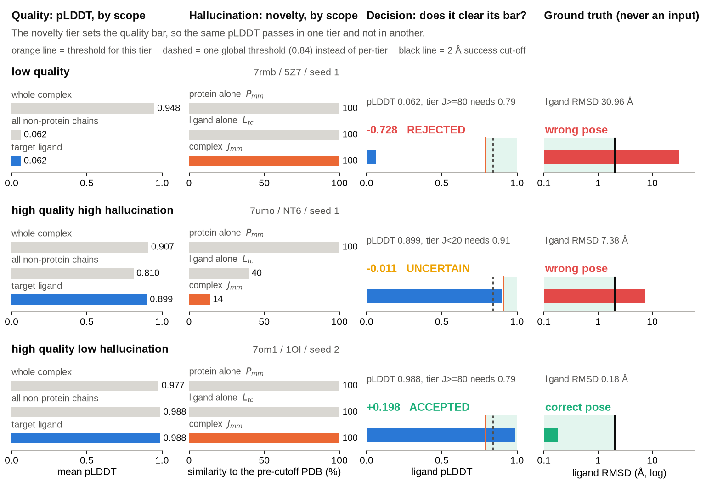

# Co-folding reliability filter

A co-folding model returns a pose for any protein–ligand pair it is given, together with a confidence
score. The score is informative, but the value corresponding to a given probability of a correct pose is not
a constant: it depends on how novel the complex is relative to the generator's training set. This directory
holds the filter calibrated for that decision.

```bash
python cofold_filter/demo/run_demo.py                                  # three cases, end to end
python cofold_filter/filter.py --csv my_predictions.csv --policy strict
python cofold_filter/novelty.py --smiles 'CC(=O)Nc1ccc(O)cc1'          # ligand novelty, runs as-is
```

## The two axes

**Quality** is the mean pLDDT over the target ligand's atoms, not the global pLDDT, and not the interface
averaged over every chain. On 5,244 predictions the AUROC for "is this pose within 2 Å" is 0.676 whole
complex, 0.821 interface over all chains, 0.885 on the target ligand alone. A ligand is a few dozen atoms
out of several hundred residues, so a complex-wide average barely sees it: the first case below has a
whole-complex pLDDT of 0.95 on a pose that is 31 Å out.

**Hallucination** is how novel the complex is. Protein and ligand novelty on their own are nearly useless as
predictors (AUROC 0.514 and 0.584); what carries signal is whether the training set held a similar protein
and a similar ligand *together*:

```
J_mm = max over (pre-cutoff PDB chain c homologous to the query, ligand l seen bound to c)
           of min(sequence identity to c, Morgan Tanimoto to l)          [0-100]
```

The two are not averaged into one score. J_mm picks a novelty tier, and the tier decides where the quality
bar sits. Inside every tier the ligand pLDDT ranks predictions about equally well (AUROC 0.844–0.912), so
what the tier changes is calibration, not ranking: the pLDDT at which a prediction is 90% likely to be
correct.

This matters because the novelty distribution shifts away from benchmark sets. Median J_mm is 56 on
Runs N' Poses, 45 on post-cutoff PoseBench and 22 on ChEMBL; the fraction below J_mm = 20 goes from 10% to
45%. A threshold calibrated on a benchmark is therefore optimistic on the data of practical interest.

Thresholds (`thresholds.csv`), one per tier and target precision. Bins are left-closed, so J = 20 falls in
20–40.

| J tier | strict (≈90%) | balanced (≈85%) | lenient (≈80%) |
|---|---|---|---|
| J < 20 | 0.91 | 0.89 | 0.84 |
| 20–40 | 0.89 | 0.83 | 0.79 |
| 40–60 | 0.85 | 0.82 | 0.77 |
| 60–80 | 0.84 | 0.80 | 0.74 |
| ≥ 80 | 0.79 | 0.67 | 0.55 |

The verdict comes from the strict and lenient thresholds of the prediction's own tier:

| state | rule | share of RNP | RMSD ≤ 2 Å | interaction recall |
|---|---|---|---|---|
| accepted | pLDDT ≥ strict | 50.5% | 90.5% | 0.87 |
| uncertain | lenient ≤ pLDDT < strict | 20.6% | 54.9% | 0.73 |
| rejected | pLDDT < lenient | 28.9% | 21.1% | 0.49 |

`uncertain` is not a synonym for `rejected`: re-folding with additional seeds, or retaining the complex at
a reduced label weight, is generally preferable to discarding it.

Against a single global threshold on the same axis (0.84 everywhere): the stratified rule keeps 50.5% of RNP
at 90.5% correct against 53.7% at 90.1% for the global one, i.e. the two are equivalent on the set they
were calibrated on. They diverge off it: 88.0% against 82.1% correct on post-cutoff PoseBench, and 90.6%
against 85.7% projected onto ChEMBL's novelty composition, at the cost of retaining a quarter of the
predictions rather than a third. The ChEMBL figure is a projection rather than a measurement, since those
complexes have no crystal structure to compare against.

## Three cases



One row per case in `demo/`; `demo/plot_cases.py` redraws this from the same files the demo reads.

**7rmb, low quality.** Whole-complex pLDDT 0.948, ligand pLDDT 0.062. The quality axis alone rejects it, and the pose is
31 Å from the crystal ligand.

**7umo, high quality and high hallucination.** Ligand pLDDT 0.899, above the 0.84 a single global threshold
would use for the same target precision, so a confidence-only filter accepts it. The protein is thoroughly
familiar (P_mm = 100) but this combination is not: the closest pre-cutoff ligand on a homologous chain is at
Tanimoto 0.40 and J_mm lands at 13.8. In that tier the bar is 0.91, so the verdict is `uncertain`, and the
pose is 7.4 Å off. Protein novelty alone would not have flagged it.

**7om1, high quality and low hallucination.** Ligand pLDDT 0.988 on a complex closely represented in the
generator's training set. Accepted, and correct to 0.18 Å.

## Calibration

2,579 Runs N' Poses systems re-folded with Boltz-1 at two MSA seeds, 5,244 predictions. Ground truth, used
only to calibrate and never as a filter input: success = ligand RMSD ≤ 2 Å after superposing the pocket Cα
atoms. Per tier the threshold is the lowest ligand pLDDT reaching the target precision while retaining at
least 30 predictions; tiers that cannot reach it at any threshold are rejected outright. External validation
on PoseBench systems released after the Boltz-1 cutoff. Confidence intervals, per-tier curves, the
interaction-recall analysis and the ablations over alternative novelty definitions are in the paper.

The thresholds are tied to Boltz-1 and to a 2021-09-30 cutoff; a different or retrained generator needs
recalibrating. And `accepted` means roughly 90% correct, so about one in ten is still wrong: the middle case
is caught, a prediction at pLDDT 0.93 in the same tier would not be.

## Files

| | |
|---|---|
| `filter.py` | `(ligand pLDDT, J_mm)` → tier and three-state verdict; also a CLI over a CSV |
| `ligand_plddt.py` | ligand pLDDT from a Boltz-1 prediction directory |
| `novelty.py` | ligand novelty `L_tc_ccd` (runs as-is), plus `P_mm` and `J_mm` given a sequence search |
| `thresholds.csv` | the calibrated table above |
| `reference/ccd_components.csv.gz` | PDB chemical components with release dates; 37,033 of them predate the cutoff |
| `demo/` | three cases with their Boltz-1 output, poses, ground truth, and the figure script |

`L_tc_ccd` works out of the box because the component list is small enough to ship. `P_mm` and `J_mm` need
the pre-cutoff chains of `pdb_seqres` and BioLiP's ligand table, neither of which is. `../DATA.md` says
where to get them, and the functions document the input they expect. In the demo those two numbers come from
`cases.csv`, and the output labels them as such.

Interaction recall is measured with ProLIF.
