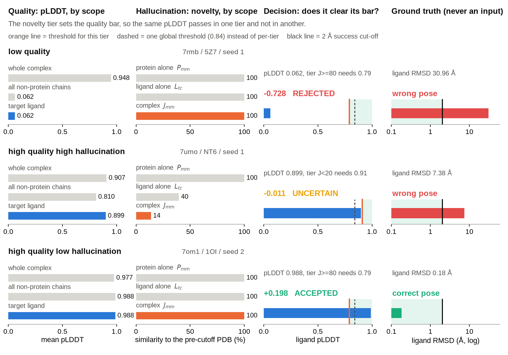

# Co-folding reliability filter

A co-folding model returns a pose for any protein–ligand pair it is given, together with a confidence
score. The score is informative, but the value corresponding to a given probability of a correct pose is not
a constant: it depends on how novel the complex is relative to the generator's training set. This directory
holds the filter calibrated for that decision.

```bash
python cofold_filter/filter.py --csv my_predictions.csv --policy strict
python cofold_filter/novelty.py --smiles 'CC(=O)Nc1ccc(O)cc1'          # ligand novelty, runs as-is
```

## 1. The two axes

**Quality** is the mean pLDDT over the target ligand's atoms, not the global pLDDT, and not the interface
averaged over every chain. On the calibration set the ligand-only mean separates correct from incorrect
poses better than either of the other two scopes. A ligand is a few dozen atoms out of several hundred
residues, so a complex-wide average barely sees it: the first case below has a high whole-complex pLDDT
on a pose that is nowhere near the crystal ligand.

**Hallucination** is how novel the complex is. Protein and ligand novelty on their own are nearly useless
as predictors; what carries signal is whether the training set held a similar protein and a similar
ligand *together*:

```
J_mm = max over (pre-cutoff PDB chain c homologous to the query, ligand l seen bound to c)
           of min(sequence identity to c, Morgan Tanimoto to l)          [0-100]
```

The two are not averaged into one score. J_mm picks a novelty tier, and the tier decides where the quality
bar sits. Inside every tier the ligand pLDDT ranks predictions about equally well, so what the tier
changes is calibration, not ranking: the pLDDT at which a prediction is likely enough to be correct.

This matters because the novelty distribution shifts away from benchmark sets: median J_mm falls from
Runs N' Poses to post-cutoff PoseBench to ChEMBL, and the share sitting in the lowest tier rises
sharply. A threshold calibrated on a benchmark is therefore optimistic on the data of practical interest.

Thresholds (`thresholds.csv`), one per tier and target precision. Bins are left-closed, so J = 20 falls in
20–40.

| J tier | strict (≈90%) | balanced (≈85%) | lenient (≈80%) |
|---|---|---|---|
| J < 20 | 0.91 | 0.89 | 0.84 |
| 20–40 | 0.89 | 0.83 | 0.79 |
| 40–60 | 0.85 | 0.82 | 0.77 |
| 60–80 | 0.84 | 0.80 | 0.74 |
| ≥ 80 | 0.79 | 0.67 | 0.55 |

The verdict comes from the strict and lenient thresholds of the prediction's own tier:

| state | rule | share of RNP | RMSD ≤ 2 Å | interaction recall |
|---|---|---|---|---|
| accepted | pLDDT ≥ strict | 50.5% | 90.5% | 0.87 |
| uncertain | lenient ≤ pLDDT < strict | 20.6% | 54.9% | 0.73 |
| rejected | pLDDT < lenient | 28.9% | 21.1% | 0.49 |

`uncertain` is not a synonym for `rejected`: re-folding with additional seeds, or retaining the complex at
a reduced label weight, is generally preferable to discarding it.

A single global threshold on the same axis does just as well on the set both were calibrated on. They
diverge off it: the stratified rule stays more precise on post-cutoff PoseBench and on ChEMBL's novelty
composition, at the cost of retaining somewhat fewer predictions.

## 2. Three cases



Columns are quality by scope, novelty by scope, the verdict, and the ground-truth RMSD.

**7rmb, low quality.** High whole-complex pLDDT, very low ligand pLDDT. The quality axis alone rejects
it, and the pose is far from the crystal ligand.

**7umo, high quality and high hallucination.** Its ligand pLDDT clears the bar a single global threshold
would use, so a confidence-only filter accepts it. The protein is thoroughly familiar but this
combination is not: no pre-cutoff chain carries a similar ligand, so J_mm lands in a low tier, where the
bar is higher and the verdict is `uncertain`. The pose is in fact wrong. Protein novelty alone would not
have flagged it.

**7om1, high quality and low hallucination.** High ligand pLDDT on a complex closely represented in the
generator's training set. Accepted, and correct.

## 3. Calibration

Runs N' Poses systems re-folded with Boltz-1 at two MSA seeds. Ground truth for calibration: success =
ligand RMSD ≤ 2 Å after superposing the pocket Cα atoms. Per tier the threshold is the lowest ligand
pLDDT reaching the target precision while still covering enough predictions to be meaningful; tiers that
cannot reach it at any threshold are rejected outright. External validation on PoseBench systems released
after the Boltz-1 cutoff.

The thresholds are tied to Boltz-1 and to a 2021-09-30 cutoff; a different or retrained generator needs
recalibrating.

## 4. Applying it to your own predictions

Three steps. Each function is independent; the CLI in `filter.py` does the last one over a CSV.

**1. Quality — ligand pLDDT.** Point it at one Boltz-1 prediction directory:

```python
from cofold_filter.ligand_plddt import ligand_plddt
q = ligand_plddt("boltz_output/predictions/<system>")      # mean pLDDT over the target ligand's atoms
```

**2. Novelty — `J_mm`.** The joint term needs a sequence search against pre-cutoff `pdb_seqres` and
BioLiP's ligand table (see `../DATA.md`); the ligand term runs with no downloads:

```python
from cofold_filter.novelty import ligand_novelty, protein_novelty, complex_novelty
ligand_novelty(smiles)                 # L_tc_ccd, against the shipped component list
protein_novelty(hits)                  # P_mm, from a hits table: fident, query_coverage
complex_novelty(smiles, homologs)      # J_mm, max over (homologous chain, ligand bound to it)
```

**3. Verdict.**

```python
from cofold_filter.filter import classify
classify(lig_plddt=q, j_mm=13.8)       # -> tier, thresholds, and accepted / uncertain / rejected
```

Over a table of predictions with `lig_plddt` and `J_mm` columns:

```bash
python cofold_filter/filter.py --csv my_predictions.csv --policy strict
```
